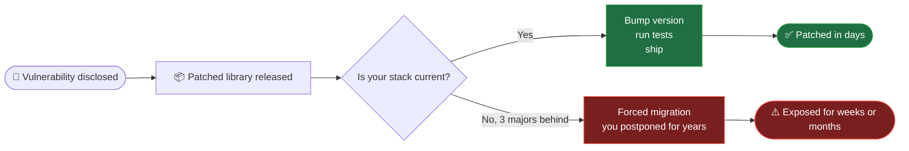

:material-language-java: Java · Spring Boot · Claude agents

# Keep every Java service current. **Without the heroics.**

An orchestrated pipeline of Claude agents that upgrades Java and Spring Boot services consistently, safely and repeatably, with a human approving every step.

[:material-rocket-launch: Quickstart](../quick-start/index.md){ .md-button .md-button--primary }
[See how it works :material-arrow-down:](#how-it-works){ .md-button }

:material-sitemap-outline: **Orchestrator** Coordinates

- :material-magnify: **Discover** Collects
- :material-scale-balance: **Determine** Plans
- :material-test-tube: **Test** Strengthens
- :material-code-braces: **Code** Upgrades

01 · The problem

## Every enterprise has that one service nobody wants to upgrade { #the-problem }

- :material-coffee-outline: Still on **Java 8**
- :material-package-variant-closed-remove: Half its dependencies are **past end-of-life**
- :material-account-off-outline: The person who understood the build **left two years ago**
- :material-cake-variant-outline: The upgrade ticket is old enough to **have an anniversary**

Now multiply that by <strong>hundreds of repositories</strong>.

### Why it never gets prioritized

:material-briefcase-outline: The business sees

- No new feature
- No visible change for customers
- "Fixes some vulnerabilities"

:material-wrench-outline: Engineering sees

- Weeks of careful work
- A risky, poorly tested build
- A growing pile of CVEs

It sounds like a chore, so it **loses to the roadmap every time**.

### What changed

Frontier models like Claude Mythos made finding vulnerabilities fast and cheap. In Anthropic's **Project Glasswing**, partners found:

10,000+
high and critical issues, in a single month

The bottleneck was not detection. It was **verifying and shipping the patches**.

!!! note "The new reality"

    **Finding the holes is fast now. Fixing them is the slow part.**

If defenders find flaws at that pace, attackers will too. When a patch lands, how fast you can apply it depends on **how current your stack is**:

Staying current isn't hygiene anymore. <strong>It's how fast you can respond when it matters.</strong>

Upgrading *one* app isn't hard. Doing it **consistently, safely and repeatedly across a portfolio** is, and it eats senior engineering time.

02 · How it works

## A controlled workflow, not one giant prompt { #how-it-works }

Not a single prompt that says *"upgrade my app"*. Each agent has **one job**, and **a human approves every phase** before the next one starts.

-   :material-magnify: [Discover](../discover/index.md)

    ---

    **Collects** a factual inventory of dependencies, versions, vulnerabilities and test coverage. Changes nothing.

-   :material-scale-balance: [Determine](../determine/index.md)

    ---

    **Plans** the upgrade from that evidence, and scores whether your tests are strong enough to trust it.

-   :material-test-tube: [Test](../test/index.md)

    ---

    **Strengthens** weak tests, round by round on its own branch, before anything is upgraded.

-   :material-code-braces: [Code](../code/index.md)

    ---

    **Upgrades** Java, Spring Boot and dependencies, one verified commit at a time.

The [Orchestrator](../orchestrator/index.md) ties the phases together, persists state between them and pauses for your approval. Nothing is merged or pushed: the result is a branch for your team to review.

03 · Why this approach

## Tools do the work. The model does the thinking. { #why-this-approach }

Most of the pipeline is **deterministic**. Anything with a known right answer is handled by proven tools, not worked out by the model each time. The LLM reasons only where there is a real need.

Deterministic

### :material-auto-fix: OpenRewrite

Recipes rewrite the Java code for the target Java and Spring Boot versions. The same migration, applied the same way, every time.

Deterministic

### :material-console: Bash and Python scripts

Run the Maven scans, reconcile dependencies and plugins, compute the testability score, track state and verify every build.

Judgment

### :material-brain: Claude

Writes the plan from the reports, writes tests that assert real behaviour, and summarises each report for you to approve.

- :material-cash-minus:

    **Fewer tokens, lower cost**

    Reasoning is spent on judgment, not on work a tool already does reliably.

- :material-repeat:

    **Reproducible**

    Same input, same output. Scans, scores and rewrites don't vary between runs.

- :material-source-commit:

    **Reviewable**

    Plans are approved before code changes. Changes land as small, verified commits.

- :material-lightning-bolt-outline:

    **Fast**

    Scans run in parallel and the analysis scripts finish in seconds.

The model thinks only where there is a real need. <strong>Fewer tokens, lower cost, and results you can reproduce.</strong>

### What it unlocks

| Before | | After |
| ------ |:-:| ----- |
| Every upgrade done differently | :material-arrow-right: | **Same playbook** every time |
| Long gap between *patch released* and *patch deployed* | :material-arrow-right: | **Shorter** exposure window |
| Surprises discovered in the diff | :material-arrow-right: | Plans reviewed **before** code changes |
| Test gaps found in production | :material-arrow-right: | Test gaps found **up front** |
| "Why did we change this?" | :material-arrow-right: | **Audit trail** of what changed and why |
| Seniors hand-editing `pom.xml` | :material-arrow-right: | Seniors **reviewing** changes |
| An LLM reasoning through every step | :material-arrow-right: | Tokens spent **only on judgment** |

!!! warning "What it is not"

    **Not** a magic *"modernize everything"* button. Humans still **approve the plan** and **review the PRs**. The goal is to take the repetitive, error-prone work off people's plates, **not the judgment**.

## Try it on your project

From zero to your first modernization run in three steps.

[:material-rocket-launch: Quick start](../quick-start/index.md){ .md-button .md-button--primary }
[:material-sitemap-outline: Meet the orchestrator](../orchestrator/index.md){ .md-button }

