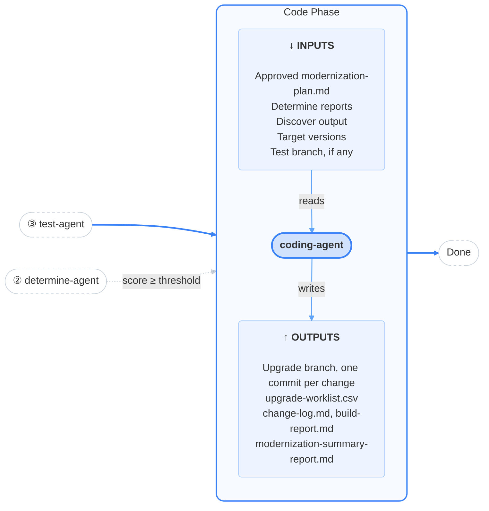
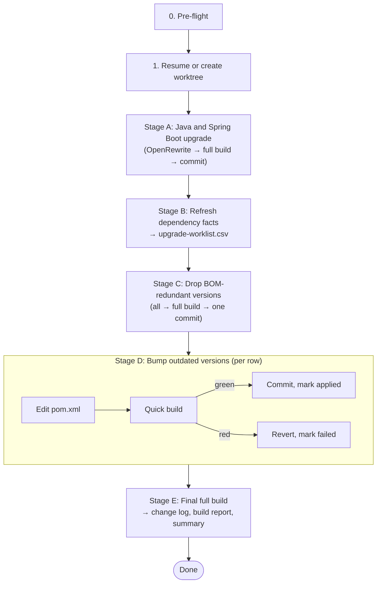

# Code

<h4>The builder of the pipeline. It upgrades Java, Spring Boot and dependencies one verified commit at a time, on a branch you review and merge.</h4>

---

<div class="motto" markdown>

:material-sitemap-outline: **Orchestrator** <span>Coordinates</span>

- :material-magnify: **Discover** <span>Collects</span>
- :material-scale-balance: **Determine** <span>Plans</span>
- :material-test-tube: **Test** <span>Strengthens</span>
- :material-code-braces: **Code** <span>Upgrades</span>

</div>

## What this is

The code phase is the only phase that changes production code. `coding-agent` upgrades Java and
Spring Boot to the versions you choose using OpenRewrite, refreshes the dependency facts against the
upgraded build, removes `<version>` elements that an imported BOM already manages, and bumps
outdated dependency, plugin and BOM versions. Every change is verified with a Maven build and test
run before it is committed, one commit per change, on a separate branch. The phase ends with a final
full build and `modernization-summary-report.md`.

### Purpose

This is where the approved plan becomes code. Small, separately verified commits mean a reviewer can
follow the upgrade step by step, and revert or cherry-pick any single change. "Verified" means the
project builds and its tests run and pass after each change. It does not guarantee identical
behaviour in production, which is why the branch is left for a person to review and merge.

## At a glance



| | |
|---|---|
| **Agent** | `coding-agent` |
| **Skills** | `upgrade-java-spring-boot`, `build-verify`, `dependency-upgrade` (also runs scripts from `inventory` and `dependency-analysis`, plus `orchestrator` for state) |
| **Inputs** | Approved `modernization-plan.md` and determine reports; discover output; your chosen target versions; the test branch, if recorded |
| **Outputs** | Branch `modernization/coding-agent-<run_id>`; `upgrade-worklist.csv`, `change-log.md`, `build-report.md`, refreshed `dependency-report.md`; `modernization-summary-report.md` |
| **Human gate** | None. Judged by whether the build and tests pass. You review the branch afterwards |
| **Human input** | Target Java and Spring Boot versions, asked once per run before the phase starts |
| **On failure** | Retries up to `MODERNIZATION_CODING_MAX_ATTEMPTS` times, then asks you to retry or abort |
| **Next** | Done |
| **Changes to your repository** | Only inside `.modernization/code/worktree`. Never merges or pushes |

## Before it starts

### Target version selection

Just before the code phase starts for the first time, the orchestrator asks you which Java and
Spring Boot versions to upgrade to. It offers `MODERNIZATION_TARGET_JAVA_VERSION` and
`MODERNIZATION_TARGET_SPRING_BOOT_VERSION` as defaults and names the versions the upgrade skill has
recipes for. Your answer is stored in `.modernization/state.json` as `gates.target_java_version` and
`gates.target_spring_boot_version`.

The question is asked by the orchestrator because an agent cannot ask you anything. It is asked
**once per run**: retries and resumed sessions reuse the stored answer.

<!-- TODO: target versions — list the supported Java and Spring Boot targets here, and how they
     relate to the target stated in modernization-plan.md, once these are aligned in code. -->

### Pre-flight checks

Nothing is touched until both halves pass. If either fails, the agent records
`error.step: preflight` and stops without creating a worktree.

**Pipeline artifacts.** The run is in `CODING_RUNNING`; the determine phase is approved;
`modernization-plan.md`, `dependency-report.md`, `plugin-report.md` and `testability-report.md` exist
in `.modernization/determine/`; discover's `effective-pom`, `version-updates` and `bom-catalog`
folders exist; and the repository is a git work tree.

**Environment.** `upgrade-java-spring-boot/scripts/pre-flight.sh` checks, reporting every problem
rather than stopping at the first:

1. **A recipe exists for each requested version.** The list of supported versions is read from the
   recipe folders on disk, so it cannot drift from what is actually available.
2. **Maven's JDK is at least the target version**, read from `mvn -v`. This is a hard check. A
   different `java` on your `PATH`, or an unset `JAVA_HOME`, only produces a warning. The check is
   "at least", not "equal": building for Java 21 on JDK 25 is fine.
3. **Project structure**: root POM present, any requested module declared, POM well-formed.

## What it does

After pre-flight, the agent upgrades the code in a separate worktree, one stage at a time. Each
change is verified with a Maven build and test run before it is committed.



| Stage | What it does | Commits |
|---|---|---|
| **A** | OpenRewrite migration to the target Java and Spring Boot versions | One, if anything changed |
| **B** | Re-checks dependency facts against the upgraded build and writes the worklist | None |
| **C** | Removes `<version>` elements that an imported BOM already manages | One for the batch |
| **D** | Bumps outdated versions | One per bump, by default |
| **E** | Final full build, then the change log, build report and summary | None |

**Empty stages are normal.** A project already at the target version has nothing for stage A; a
project already relying on BOM-managed versions has nothing for stage C. Both are recorded as
completed, not treated as failures, and no empty commit is made.

### Step 1: Resume or create the worktree

On a fresh run the agent creates `.modernization/code/state.json` and the worktree:

```bash
git worktree add .modernization/code/worktree -b modernization/coding-agent-<run_id> <base-ref>
```

**The base is the test branch when one is recorded.** If `.modernization/test/state.json` has
`outputs.worktree_branch`, the code branch starts from it, so the upgrade is verified against the
improved tests. Otherwise it starts from `HEAD`. The choice is stored as `outputs.base_ref`. (See
[Known gaps](#known-gaps).)

If the worktree already exists, the agent reuses it, first discarding any **uncommitted** changes.
Every verified change is already committed, so anything uncommitted is unverified work from an
interrupted session. It then resumes at the first stage not marked completed.

### Stage A: Java and Spring Boot upgrade

```bash
apply-recipes.sh --workdir .modernization/code/worktree \
  --output-dir .modernization/code/upgrade-java-spring-boot \
  --java-version <v> --spring-boot-version <v>
build-verify.sh .modernization/code/worktree .modernization/code/build-verify/stage-a
```

`apply-recipes.sh` combines the recipe files for the requested versions into one `rewrite.yml` and
runs `mvn rewrite:run`, with a one-hour timeout by default. Its status line reports how many files
changed.

- **No files changed**: the project is already at the target. Recorded, no commit.
- **Build green**: committed. There is no scope check here, because an OpenRewrite migration is
  expected to change both production and test source.
- **Build red**: the agent reads the extracted errors, repairs the source and re-verifies, within a
  limited budget. If it cannot repair it, the phase fails with `step: java_spring_upgrade`.

Stage A is committed before stage B starts, so the most expensive work survives a later failure.

**Output:** one commit; `upgrade-java-spring-boot/rewrite.yml`, `logs/rewrite.log`, and
`rewrite-errors.txt` on failure

### Stage B: Refresh dependency facts

The determine phase's dependency report was written before the upgrade. The new Spring Boot parent or
BOM now manages versions it did not before, and some recommended bumps may already have been applied
by OpenRewrite. So the agent re-runs the relevant scripts against the worktree (not the phases: no
state changes and no approval gates are reopened):

1. `inventory-orchestrator.sh --only effective-pom,version-updates` in the worktree (deliberately
   without `--force`, which would also re-run the slow coverage and CVE tasks)
2. `generate-dependency-report.sh` in the worktree, copied to `.modernization/code/dependency-report.md`
3. `plan-upgrades.sh`, which runs `versions:display-property-updates` and combines it with the
   refreshed report to produce the worklist

**Why property updates matter.** Most POMs set versions through properties
(`<version>${kotlin.version}</version>`), and one property can move several dependencies at once.
The report alone also cannot see past an imported BOM: dozens of rows can look "managed by
spring-boot-dependencies" when that BOM's own version is a property in your root POM. Property
updates make those reachable. Pre-releases (alpha, beta, milestone, release candidate, snapshot) are
excluded.

The agent marks this stage completed before moving on and **never re-runs it once bumps have
started**, because regenerating the worklist would reset every applied row to pending and lose the
record of what already landed.

**Output:** `upgrade-worklist.csv`, refreshed `dependency-report.md`

The worklist has one row per planned edit:

| Column | Meaning |
|---|---|
| `stage` | `C` (remove a redundant version) or `D` (bump) |
| `action` | `drop-version`, `bump-version` or `none` |
| `edit_kind` | `property` or `version`: which kind of edit to apply |
| `edit_pom`, `locator` | Which POM, and which property or `groupId:artifactId` |
| `current_version`, `target_version` | From and to |
| `status` | `pending`, `applied`, `failed`, `deferred`, `covered` or `skipped` |
| `commit`, `note` | The commit that applied it, or why it failed |

`covered` means the row cannot be edited directly but **moves anyway** because the BOM that manages it
is being bumped. Recording this keeps the change log honest about why a dependency changed.

### Stage C: Drop BOM-redundant versions

All `drop-version` rows are one logical change, so the agent removes them all, runs one full build,
checks that only `pom.xml` files changed, and makes one commit.

If the build fails, it reverts them all, re-applies them one at a time with quick builds, and marks
the ones that break the build as `failed`. A removal that breaks the build means the report's
"managed by this BOM" inference was wrong for that row, which is useful to know. This is not a phase
failure.

**Output:** one commit; worklist rows `applied` or `failed`

### Stage D: Bump outdated versions

For each pending `stage=D` row, by default one at a time:

1. Edit the POM: `set-property` for a property, `set-version` for a literal version.
2. Run a quick build (`build-verify.sh --quick`, without `clean`).
3. **Green**: check that only `pom.xml` files changed, commit, mark the row `applied` with the commit.
4. **Red**: revert that POM, mark the row `failed` with the first error line, move on.
5. Record progress in `steps.dependency_bumps.progress`.

**A failed bump is never a phase failure.** One dependency that cannot be upgraded must not discard
the ones that could.

`apply-pom-edit.sh` changes at most one line and leaves every other byte of the file as it was, so
each commit's diff shows exactly the change and nothing else. It refuses to set a literal version on a
dependency whose version is a property, and names the property to edit instead. It writes to a
temporary file and renames it, so an interrupted edit cannot leave a broken POM.

With `MODERNIZATION_CODING_BUMP_BATCH_SIZE` above 1, that many bumps are applied per build; if the
build fails, the batch is reverted and re-applied one at a time. With `MODERNIZATION_CODING_MAX_BUMPS`
above 0, rows beyond the limit are marked `deferred`, not lost. Rows marked `covered` need no action.

**Output:** one commit per applied bump; worklist rows updated as each finishes

### Stage E: Final verification and reports

1. One **full** build (`clean install`, no `--quick`). Nothing is reported as finished on quick builds
   alone. A red final build means an interaction the quick builds hid: the agent tries to repair it,
   and if it cannot, the phase fails with `step: final_verify` and **no success report is written**.
2. Writes the reports below.
3. Sets `status: completed` and records the outcome in `outputs`.

**Output:**

| File | Contents |
|---|---|
| `.modernization/code/change-log.md` | Stage A summary (versions before and after, recipes, files changed, commit); stage C and D tables; a "Deferred and failed" section with reasons, so nothing silently disappears |
| `.modernization/code/build-report.md` | One row per build: stage, quick or full, status, duration, test counts. This is the evidence behind "every commit is green" |
| `.modernization/modernization-summary-report.md` | The page to read first. Outcome (versions before and after, final build, counts); links to every phase's report; gains realized compared with the plan; what is left; where to see the changes and the branch base |

### What "verified green" guarantees

`build-verify.sh` runs the build and test suite, writes all Maven output to a log, and reports one
status line plus `build-summary.json`. Its exit codes:

| Exit | Meaning |
|---|---|
| `0` | Build succeeded **and** the test checks below passed |
| `1` | Build failed; see `build-errors.txt` |
| `3` | Build succeeded but the tests did not really run |
| `124` | Timed out (default one hour) |
| `2` | Usage error |

**Every commit is independently green.** One change, one verification, one commit. `git log` on the
branch is a list of verified steps.

**A green build is not accepted as a green suite.** Maven also succeeds when tests are skipped or
missing, so `build-verify` adds two checks:

- At least one test must have run, unless the project has no test sources at all.
- If an earlier build in this run had tests and this one reports none, that is a failure (exit 3).
  The highest count seen is kept as a baseline and never lowered, so a regression cannot hide its own
  evidence.

Only test reports written by **this** build are counted, so stale reports from an earlier build
cannot make a skipped suite look like a passing one. A **partial** drop in test count is a warning,
not a failure, because a recipe can legitimately merge tests; the agent must judge it and record its
reasoning in the change log.

**Tests are never weakened to make a build pass.** Adapting a test to a renamed API is repair.
Changing an assertion, disabling or deleting a test, narrowing the suite, or skipping tests is not;
the agent is instructed to stop and escalate instead.

**What it does not guarantee:** behaviour in your runtime environments, integration with other
services, performance, or anything your tests do not cover.

### Commits

Commits use [Conventional Commits](https://www.conventionalcommits.org/) with type `build`, scoped by
the skill that drove the change, and the build result in the body:

```
build(upgrade-java-spring-boot): upgrade to Java 21 and Spring Boot 4.0
build(dependency-upgrade): drop 14 versions managed by spring-boot-dependencies
build(dependency-upgrade): bump ${kotlin.version} to 2.4.20

Build: SUCCESS (231 tests run, 0 failed).
```

(Illustrative examples of the format.)

### Outputs summary

```
.modernization/
├── code/
│   ├── worktree/                   Git worktree on modernization/coding-agent-<run_id>
│   ├── upgrade-java-spring-boot/   Combined recipes and rewrite log
│   ├── build-verify/               One folder per build: log, summary, errors
│   ├── dependency-report.md        Refreshed after the upgrade
│   ├── upgrade-worklist.csv        Per-row status; the resume record for stage D
│   ├── change-log.md               ► What changed, row by row
│   ├── build-report.md             ► Every build and its test counts
│   └── state.json
└── modernization-summary-report.md ► Read this first
```

## Failure handling

| Situation | Response | Phase failure? |
|---|---|---|
| Pre-flight fails | Stops before creating a worktree | Yes (`preflight`) |
| Stage A build red | Repair source and re-verify within a budget | Yes, if unrepairable (`java_spring_upgrade`) |
| Build exit 3 (tests did not run) | Treated as red. Never fixed by skipping tests | Depends on stage |
| Test count dropped partially | Agent judges and records reasoning in the change log | No |
| Stage C build red | Bisect, mark offending rows `failed`, continue | No |
| Stage D bump red | Revert that POM, mark row `failed`, continue | No |
| Stage E full build red | Repair; no success report if unrepairable | Yes, if unrepairable (`final_verify`) |

On a phase failure the agent records `error` (`message`, `step`, `occurred_at`), leaves the worktree
in place and stops. The orchestrator then retries the phase if attempts remain, or asks you to retry
or abort. A retry continues from the completed stages and the worklist; it does not start over.
`attempt` counts entries into the code phase, not individual failed builds.

## Reviewing and merging the result

Nothing is merged into your branch and nothing is pushed. Start with
`.modernization/modernization-summary-report.md`, then inspect the branch:

```bash
git -C .modernization/code/worktree log --oneline modernization/coding-agent-<run_id>
git -C .modernization/code/worktree diff <base-ref> modernization/coding-agent-<run_id>
```

`<base-ref>` is in the summary report and in `outputs.base_ref`. When reviewing:

- **Stage A commit**: the largest diff. Check OpenRewrite's changes and any repairs the agent made
  afterwards, especially to tests.
- **Stage C and D commits**: one-line POM changes. Check the "Deferred and failed" section of the
  change log for anything that still needs a person.
- **Build report**: confirm test counts stayed stable across the run.
- **Test-count warnings**: read the agent's reasoning in the change log.

When satisfied, push the branch and open a pull request through your normal review process, or merge
it locally. Pushing requires your confirmation; `git push` is never allowed automatically.

## Configuration

| Variable | Default | Meaning |
|---|---|---|
| `MODERNIZATION_TARGET_JAVA_VERSION` | `25` | Default Java version offered when you are asked for the target |
| `MODERNIZATION_TARGET_SPRING_BOOT_VERSION` | `4.0` | Default Spring Boot version offered |
| `MODERNIZATION_CODING_MAX_ATTEMPTS` | `3` | Code phase attempts before asking you to retry or abort |
| `MODERNIZATION_CODING_BUMP_BATCH_SIZE` | `1` | Bumps applied per build verification. Larger is faster but makes a failure harder to pin down |
| `MODERNIZATION_CODING_MAX_BUMPS` | `0` | Maximum bumps per code-phase invocation; `0` means no limit. Rows over the limit are marked `deferred` |

The target defaults are read when the orchestrator asks you; your answer is then fixed for the run.
`MODERNIZATION_CODING_MAX_ATTEMPTS` is copied into the phase's `max_attempts` when the phase first
starts. Batch size and maximum bumps are read when stage D runs.

## Known gaps

- **The code phase may not build on the test branch.** The test agent does not currently record
  `outputs.worktree_branch`, so the code branch may start from `HEAD` instead of the test branch.
  Check `outputs.base_ref` in `.modernization/code/state.json`. If it is `HEAD` and you want the new
  tests included, merge the test branch into the code branch yourself before reviewing.
- **`inventory-orchestrator.sh` can hang after its tasks finish**, which blocks stage B when running
  unattended. The artifacts are complete and correct when this happens; the process does not exit.
- **The stage A repair loop and the attempt-cap escalation** have not yet been exercised against a
  real failing migration.

<!-- TODO: target versions — add the gap between the plan's stated target and the available
     recipes here, or remove this note, once resolved in code. -->

## Troubleshooting

| Symptom | Cause | Fix |
|---|---|---|
| Pre-flight: JDK too old | Maven runs on an older JDK than the target, often because `JAVA_HOME` points to it | Set `JAVA_HOME` to a newer JDK and check `mvn -v` |
| Pre-flight: no recipe for the requested version | The chosen version is not in the recipe folders | Choose a listed version |
| Phase failed at `java_spring_upgrade` | OpenRewrite left breakage the agent could not repair | Read `build-verify/stage-a/build-errors.txt` and `upgrade-java-spring-boot/rewrite-errors.txt`; fix in the worktree or adjust targets, then retry |
| A bump keeps failing | The new version is incompatible with your code or other dependencies | Expected; it is listed under "Deferred and failed" for a person to handle |
| Stage B never finishes | The `inventory` hang described in Known gaps | Check that `effective-pom` and `version-updates` show `state=SUCCESS` in their `logs/status` files under `.modernization/code/worktree/.modernization/discover/`, then stop the session and resume. Successful tasks are reused, so the re-run is short |
| Phase failed at `final_verify` | Changes that each passed a quick build fail together | Find the combination with `git bisect` on the branch, or retry |

