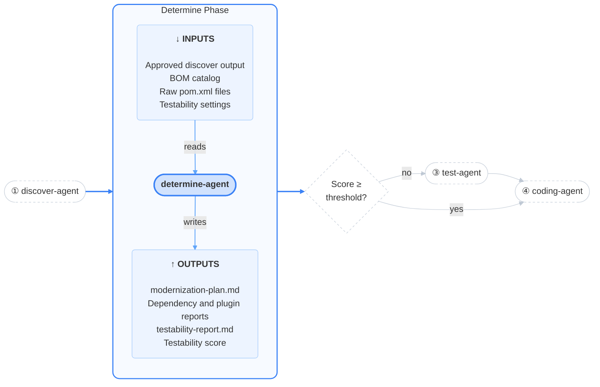
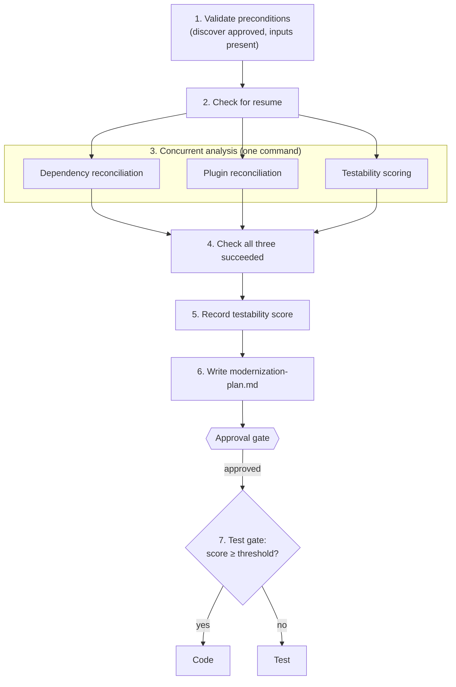
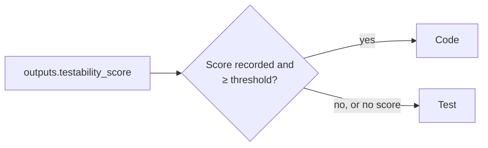

# Determine

<h4>The planner of the pipeline. It turns the evidence into reports, a testability score and a plan you approve before any code is touched.</h4>

---

<div class="motto motto--second" markdown>

:material-sitemap-outline: **Orchestrator** <span>Coordinates</span>

- :material-magnify: **Discover** <span>Collects</span>
- :material-scale-balance: **Determine** <span>Plans</span>
- :material-test-tube: **Test** <span>Strengthens</span>
- :material-code-braces: **Code** <span>Upgrades</span>

</div>

## What this is

The determine phase turns the discover phase's raw evidence into a plan. `determine-agent` runs three
scripts at the same time: one reconciles your dependencies against the BOM catalog, available
updates and known vulnerabilities; one does the same for your Maven build plugins; and one combines
JaCoCo coverage and PIT mutation strength into a single **testability score**. The agent then reads
the three reports and writes `modernization-plan.md`, which you approve before any code is touched.

### Purpose

This phase separates "what is" from "what should change". The scripts produce facts; the agent's only
judgment call is writing the plan from those facts; you review the plan before anything happens. It
also produces the number that decides the next step: if your tests are too weak to trust, the
pipeline strengthens them before upgrading anything.

## At a glance



| | |
|---|---|
| **Agent** | `determine-agent` |
| **Skills** | `dependency-analysis`, `test-analysis` (plus `orchestrator` for state) |
| **Inputs** | Approved discover output in `.modernization/discover/`, the BOM catalog, your raw `pom.xml` files, the testability settings |
| **Outputs** | `dependency-report.md`, `plugin-report.md`, `testability-report.md`, `testability-data.csv`, `modernization-plan.md`, and the score in `state.json` |
| **Human gate** | Yes: approve or reject `modernization-plan.md` |
| **Next phase** | Test gate: Test if the score is below the threshold, Code otherwise. Determine again with your reason on reject |
| **Network access** | None; it reads only what discover collected |
| **Changes to your repository** | None |

## What it does

The agent checks that discover was approved, runs the three analysis scripts side by side, and
writes the plan from their reports. After you approve the plan, the test gate picks the next phase.



### Stage 1: Validate preconditions

The agent confirms that the discover phase is approved in `.modernization/state.json` and that the
discover folders it needs exist: `effective-pom`, `sbom`, `dependency-vulnerabilities`,
`version-updates`, `bom-catalog`, `coverage-jacoco` and `coverage-pitest`. A discover task that was
skipped is acceptable; a missing required input stops the phase with a message naming it.

### Stage 2: Check for resume

The agent reads `.modernization/determine/state.json`, creating it on a fresh run. The three scripts
regenerate their reports from scratch each time and take seconds, so a resumed run simply runs them
again.

### Stage 3: Concurrent analysis

All three scripts start in a single command and run side by side. They only read discover's output
and your `pom.xml` files, and each writes its own files, so they cannot interfere. Each script's full
output goes to a log file; only a one-line status comes back to the agent.

#### Dependency reconciliation

`dependency-analysis/scripts/generate-dependency-report.sh` reads the effective POM, the SBOM, the
version updates, the vulnerability scan, the BOM catalog and your raw `pom.xml` files. Reading the raw
files is what lets it tell "this version is managed by a BOM" apart from "this version is hard-coded".

It produces one table per module, with a row for each dependency the module declares or inherits
(dependencies between your own modules are excluded):

| Column | Meaning |
|---|---|
| Version and scope | What the module uses today |
| Inherited | Whether it comes from a parent POM |
| Latest | The newest stable version available |
| Vulnerabilities | Any CVE affecting this dependency **or anything it pulls in**, linked to details |
| Managed by | What sets the version: the project, the parent, a BOM, or nothing |

A **Vulnerabilities** section at the end gives each CVE's severity, CVSS score, fixed version and the
dependency chain that brings it in.

**Output:** `dependency-report.md` (logs in `dependency-analysis/logs/`)

#### Plugin reconciliation

`dependency-analysis/scripts/generate-plugin-report.sh` does the same for `<build><plugins>`: version,
whether it is inherited, latest version, and what manages it (project, parent, `pluginManagement`, or
nothing). Plugins have no vulnerability column, because they are not covered by the SBOM or the CVE
scan.

**Output:** `plugin-report.md`

#### Testability scoring

`test-analysis/scripts/generate-testability-report.sh` combines JaCoCo and PIT results for each class
and for the project overall:

```
score = line coverage % × MODERNIZATION_JACOCO_WEIGHT
      + PIT test strength % × MODERNIZATION_PIT_WEIGHT
```

With the defaults that is 60% line coverage and 40% mutation strength. A class with only one of the
two measurements (for example, no mutations were generated for it) is scored on the one it has. A
class with neither is left out of the score.

The report contains the settings used and where they came from, an overall table (instruction,
branch, line and method coverage, PIT test strength and mutation coverage, the weighted score, and
whether it is above or below the threshold), a per-module summary, and the classes below the
threshold, worst first.

**Output:** `testability-report.md`, `testability-data.csv` (every class, including excluded ones;
logs in `test-analysis/logs/`)

### Stage 4: Check all three succeeded

All three scripts are required. If any fails, the agent records which one in its state file and
stops. It never writes a plan from a partial set of reports.

### Stage 5: Record the testability score

The scoring script ends with the line `Overall weighted testability score: NN.NN%`. The agent copies
that number into `.modernization/determine/state.json` as `outputs.testability_score`. The test gate
reads it from there, not from the plan's text.

### Stage 6: Write the plan

The agent reads the three reports in full and writes `modernization-plan.md`. This is the one step
in the phase that involves judgment. The plan has five sections:

| Section | Contents |
|---|---|
| 1. Summary | Links to the three reports |
| 2. Technology stack | Current Java and Spring Boot versions and other major frameworks, deduced from the reports |
| 3. Test improvement plan | If the score is below the threshold, a plan for the test phase. Otherwise, the recommended changes from the dependency and plugin reports |
| 4. Dependency and plugin upgrades plan | Whether the root POM's parent should be upgraded first; the target versions; a statement that the code phase handles the remaining upgrades and code changes |
| 5. Modernization gains | What approving the plan should achieve: CVEs resolved, dependencies and plugins brought current, end-of-life exposure removed, test improvement if the test phase runs. Quantified only where the reports support it |

!!! warning "Section 4's target is fixed text"

    Section 4 always says *"Java 21 and Spring Boot 4.1 or later"*. The plan template hard-codes this;
    it is not derived from your project or your settings. The versions actually applied are the ones
    you choose when the code phase starts (supported: Java `17`, `21`, `25`; Spring Boot `3.5`, `4.1`).
    See [Code → Target version selection](../code/index.md#target-version-selection).

Section 4 deliberately does not reason about individual dependencies or name OpenRewrite recipes.
That work belongs to the code phase, which re-checks dependency facts after the upgrade.

The agent then marks the `report` step complete and sets `status: reported`.

**Output:** `modernization-plan.md`

### Stage 7: The test gate

After you approve the plan, the orchestrator compares the score with the threshold copied into
`gates.testability_threshold` when the run started:



Two details matter:

- The comparison uses the **whole-number part** of the score and threshold, so a score of 79.9 against
  a threshold of 80 goes to the test phase.
- If no score could be recorded, the pipeline treats it as below the threshold and runs the test
  phase, rather than skipping the safety net.

### Outputs summary

All paths are under `.modernization/determine/`.

| Artifact | Produced by | Used by | For people? |
|---|---|---|---|
| `modernization-plan.md` | Agent | You, at the gate; code | Yes |
| `dependency-report.md` | Dependency script | Plan; code pre-flight | Yes |
| `plugin-report.md` | Plugin script | Plan; code pre-flight | Yes |
| `testability-report.md` | Scoring script | Plan; test phase starting point | Yes |
| `testability-data.csv` | Scoring script | Test phase (which classes to target) | Readable |
| `state.json` → `outputs.testability_score` | Agent | Test gate | No |
| `dependency-analysis/logs/`, `test-analysis/logs/` | Scripts | You, when debugging | Yes |

## The approval gate

The orchestrator shows a summary of `modernization-plan.md` and asks you to approve or reject it.
Unlike the discover report, this is the agent's interpretation, so read it critically:

- **Technology stack**: does it match what you know about the project?
- **Test improvement plan**: if the score is below the threshold, are the targeted areas sensible?
- **Parent POM recommendation**: is upgrading the parent first appropriate for your project?
- **Gains**: are they supported by the reports, or overstated?
- **Score**: check it in `testability-report.md` alongside the per-class table. It decides whether the
  test phase runs.

**Approve** and the test gate decides the next phase.

**Reject with a reason** and the agent runs again with it. It decides whether your reason means an
analysis is wrong (re-run the affected script, for example "this CVE is already patched") or the plan
is wrong (rewrite only the plan, for example "the priorities are in the wrong order"). It prefers the
narrower fix.

## Configuration

| Variable | Default | Meaning |
|---|---|---|
| `MODERNIZATION_TESTABILITY_THRESHOLD` | `80` | Score (%) at or above which the test phase is skipped. Also shown in `testability-report.md` and used to list classes below threshold |
| `MODERNIZATION_JACOCO_WEIGHT` | `0.6` | Weight of JaCoCo line coverage, per class and overall |
| `MODERNIZATION_PIT_WEIGHT` | `0.4` | Weight of PIT test strength, per class and overall |

How these are read:

- The **scoring script reads them from the environment** each time it runs. Claude Code passes the
  `env` block from `settings.json` to every command an agent runs.
- The **test gate uses the threshold copied into the run's state at start-up**
  (`gates.testability_threshold`), not the current value in `settings.json`.
- If the variables are not set at all, for example when running the script by hand outside Claude
  Code, the script falls back to built-in defaults (80, 0.6, 0.4). The report's "Configuration" section
  says which source was used.

Keep the two weights summing to 1, and change them before the run starts.

All three scripts take an optional first argument, the path to the `.modernization` folder. It
defaults to `./.modernization`, so run them from the repository root.

## Troubleshooting

| Symptom | Cause | Fix |
|---|---|---|
| `required input not found: …/coverage-jacoco/jacoco.csv` (or `test-strength.xml`) | Discover's coverage tasks produced no output, or the script was run from the wrong folder | Check discover's `summary.md`; run scripts from the repository root or pass the path |
| `python3 (or python) is required but was not found on PATH` | Python missing | Install Python 3; no packages needed |
| Phase fails with a script error | One of the three scripts exited non-zero | Read `dependency-analysis/logs/<script>.stderr.log` or `test-analysis/logs/testability-report.stderr.log` |
| Score looks wrong, or did not change after editing `settings.json` | Settings not visible to the script, or changed after the run started | Check the report's "Configuration" source line; see [Configuration](#configuration) |
| Test phase ran although the score looked close to the threshold | Whole-number comparison (79.9 vs 80) | Expected behaviour |
| Determine refuses to start | Discover not approved, or a required discover folder is missing | Approve discover, or re-run it |

