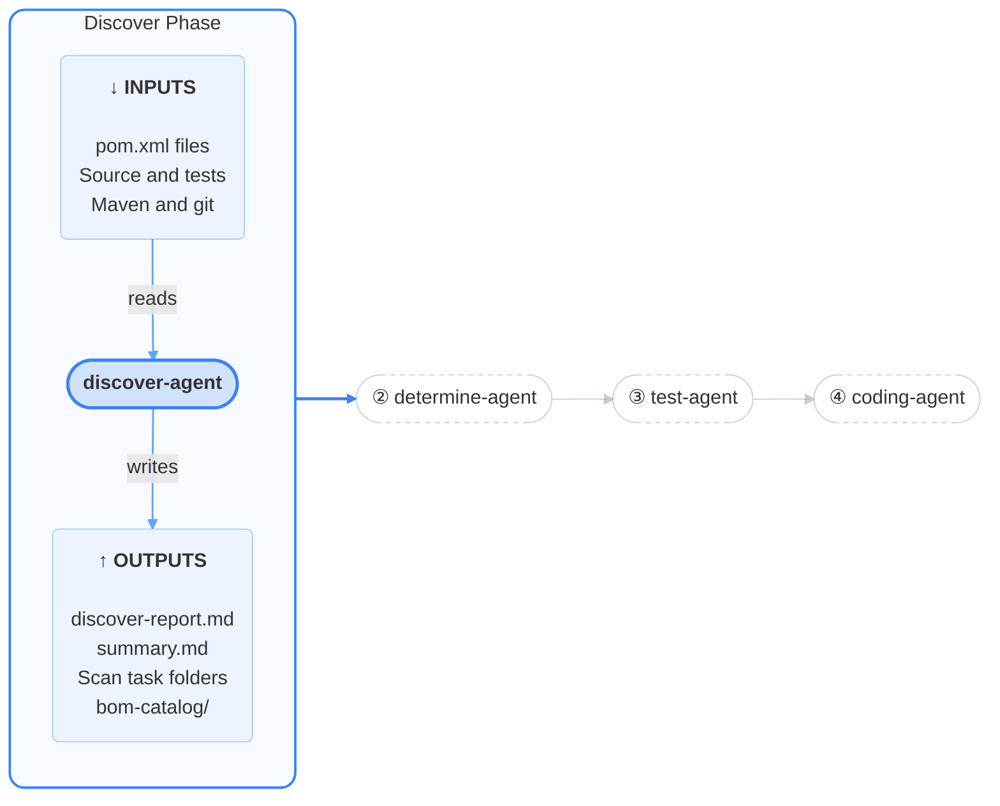
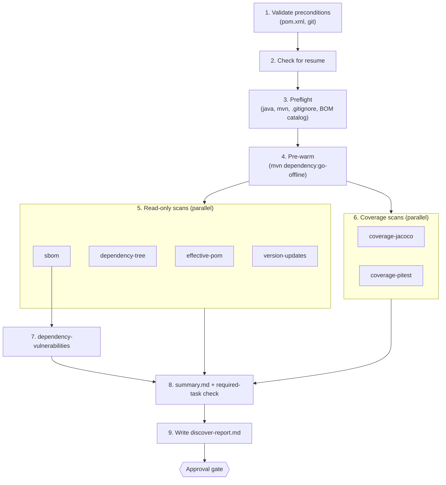

# Discover

<h4>The surveyor of the pipeline. It takes a factual inventory of your build, dependencies, vulnerabilities and tests, and changes nothing.</h4>

---

<div class="motto motto--first" markdown>

:material-sitemap-outline: **Orchestrator** <span>Coordinates</span>

- :material-magnify: **Discover** <span>Collects</span>
- :material-scale-balance: **Determine** <span>Plans</span>
- :material-test-tube: **Test** <span>Strengthens</span>
- :material-code-braces: **Code** <span>Upgrades</span>

</div>

## What this is

The discover phase takes a factual inventory of your repository before anything is planned or
changed. `discover-agent` runs the `inventory` skill, which uses Maven and a few standard tools to
produce the effective POM, the dependency tree, a software bill of materials (SBOM), a list of
available version updates, a vulnerability scan, JaCoCo code coverage and PIT mutation testing
results. The agent then writes `discover-report.md`, an index of links to everything that was
produced, and the pipeline stops for you to approve it. Nothing in your source code is changed.

### Purpose

Every later decision depends on evidence collected here: the upgrade plan is built from the
dependency and version data, and the decision to strengthen tests first comes from the coverage
data. Keeping collection separate from interpretation means you can check the raw facts before
anyone draws conclusions from them. Discover **collects**; it does not score, rank or recommend
anything. That is the determine phase's job.

## At a glance



| | |
|---|---|
| **Agent** | `discover-agent` |
| **Skills** | `inventory` (plus `orchestrator` for state) |
| **Inputs** | The target repository: `pom.xml` files, source, tests; Maven and git |
| **Outputs** | `.modernization/discover/`: one folder per scan task, `summary.md`, `bom-catalog/`, `discover-report.md` |
| **Human gate** | Yes: approve or reject `discover-report.md` |
| **Next phase** | Determine (on approve); discover again with your reason (on reject) |
| **Changes to your repository** | Adds `.modernization/` to `.gitignore` if missing. No source changes |


## What it does

The agent checks preconditions, runs the `inventory` skill, and turns its output into the report.
Inside the skill, the read-only scans and the coverage scans run at the same time; the vulnerability
scan waits only for the SBOM.



### Stage 1: Validate preconditions

The agent confirms there is a `pom.xml` at the repository root and that git is available. If either
is missing it stops with a message naming what it expected, before running anything.

### Stage 2: Check for resume

The agent reads `.modernization/discover/state.json`. If the file does not exist, this is a fresh
run and the agent creates it with the run ID and `status: running`. If it exists from an earlier,
interrupted session, the agent simply runs the skill again: the skill itself decides which tasks
can be reused.

**Resuming within the skill.** Each scan task records a fingerprint of its inputs (the relevant
`pom.xml` and source files, plus the Java, Maven and plugin versions). On a re-run, a task that
succeeded before and whose fingerprint still matches is reused; anything that failed, was skipped,
is missing or is out of date runs again. You can see the plan without running anything:

```bash
.claude/skills/inventory/scripts/inventory-orchestrator.sh --status
```

### Stage 3: Preflight

- Checks that `java` and either `./mvnw` or `mvn` are available. `./mvnw` is preferred when present.
- If the repository is a git work tree, adds `.modernization/` to `.gitignore` when that exact line is
  missing. If it is not a git work tree, warns that mutation testing will be skipped.
- Copies the skill's bundled BOM catalog into `.modernization/discover/bom-catalog/`, replacing any
  previous copy.

**Output:** `bom-catalog/` (`catalog.json`, `catalog.yaml`, `bom-catalog-v1.schema.json`)

The BOM catalog is reference data, not a scan result. It describes the Spring Boot dependencies BOM
and the BOMs it imports. Discover does not read it; it is staged here so the determine phase can
reconcile your dependencies against it.

### Stage 4: Pre-warm

If any task needs to run, the skill runs `mvn dependency:go-offline` once, so the parallel tasks do
not all download the same artifacts. If this fails, the skill carries on and each task downloads
what it needs.

### Stage 5: Read-only scans

These four run in parallel and do not modify anything.

| Task | What it does | Output |
|---|---|---|
| `effective-pom` | Resolves the full POM with parents and profiles applied | `effective-pom/effective-pom.xml` |
| `dependency-tree` | Resolves the dependency graph | `dependency-tree/dependency.txt`, `dependency.dot` |
| `sbom` | Generates a CycloneDX SBOM for the whole build | `sbom/sbom.cdx.json`, `sbom.cdx.xml` |
| `version-updates` | Lists newer versions of dependencies and plugins, excluding pre-releases | `version-updates/dependency-updates.txt`, `plugin-updates.txt` |

`effective-pom`, `dependency-tree` and `sbom` are **required**: if any of them fails, the phase fails
and no report is written. `version-updates` is optional.

### Stage 6: Coverage scans

These run alongside stage 5. By default each runs in its own git worktree so that they do not
interfere with each other or with your checkout.

| Task | What it does | Output |
|---|---|---|
| `coverage-jacoco` | Runs the test suite with JaCoCo and aggregates line, branch, instruction and method coverage | `coverage-jacoco/jacoco.csv`, `coverage-summary.txt`, per-module HTML |
| `coverage-pitest` | Runs PIT mutation testing: introduces small code changes and checks whether the tests catch them | `coverage-pitest/mutations.xml`, `test-strength.xml` |

Both are optional. `coverage-pitest` skips itself, with the reason recorded, when:

- the repository is not a git repository or has no commits yet;
- the test suite does not pass (mutation testing needs a green suite to mean anything);
- the project already configures `pitest-maven` itself.

These two tasks take most of the phase's time, because PIT re-runs tests for each mutation.

No score is computed here. The determine phase turns these numbers into the testability score.

### Stage 7: Vulnerability scan

Once the SBOM exists, `dependency-vulnerabilities` scans it for known CVEs (Common Vulnerabilities
and Exposures). By default it uses `grype`; JFrog CLI (`jf`) is also supported (see
[Configuration](#configuration)).

**Output:** `dependency-vulnerabilities/vulns.json` (grype) or `sbom.enriched.cdx.json` (JFrog CLI)

Without a scanner the task is skipped and the report says so. Treat a skipped scan as "not
assessed", not as "no vulnerabilities". The scan reflects the vulnerability database at the time it
ran.

### Stage 8: Summary and required-task check

The skill writes `summary.md`, a table of every task with its state (including whether it was reused
from a previous run) and duration. It exits with an error if any required task did not succeed. In
that case the agent records the failure in its state file and stops.

**Output:** `summary.md`

### Stage 9: Write the report

The agent fills a fixed template with links to the artifacts above. It adds no commentary, ranking
or scoring. Any skipped optional task appears as a one-line note in place of its link. The agent then
marks the `report` step complete and sets `status: reported`.

**Output:** `discover-report.md`

### Outputs summary

All paths are under `.modernization/discover/`.

| Artifact | Produced by | Used by | For people? |
|---|---|---|---|
| `discover-report.md` | Agent | You, at the gate | Yes |
| `summary.md` | Skill | You, the report | Yes |
| `effective-pom/effective-pom.xml` | `effective-pom` | Determine (both reports), code | No |
| `dependency-tree/dependency.txt` | `dependency-tree` | You (reference) | Readable |
| `sbom/sbom.cdx.json` | `sbom` | Vulnerability scan, determine | No |
| `version-updates/*.txt` | `version-updates` | Determine, code | Readable |
| `dependency-vulnerabilities/vulns.json` | `dependency-vulnerabilities` | Determine | No |
| `coverage-jacoco/jacoco.csv` | `coverage-jacoco` | Determine (score) | No |
| `coverage-pitest/test-strength.xml` | `coverage-pitest` | Determine (score) | No |
| `bom-catalog/catalog.json` | Preflight | Determine | No |
| `<task>/logs/` | Each task | You, when debugging | Yes |
| `state.json` | Agent and orchestrator | Resume, monitoring | Readable |

Each task folder has a `logs/` folder containing `stdout.log`, `stderr.log`, `status` (one line:
state, exit code, duration), `meta.json` (tool versions, timing) and `fingerprint`.

## The approval gate

The orchestrator shows a short summary of `discover-report.md` and asks you to approve or reject it.
Before approving, open the report and check:

- **Every scan you expect actually ran.** Skipped tasks are listed in place of their links, with the
  reason. A skipped coverage task means the testability score will be based on less data.
- **The vulnerability scan ran**, or you accept that it was not assessed.
- **`summary.md` shows no failures** and plausible durations.

**Approve** and the run moves to the determine phase.

**Reject with a reason** and the agent runs again with your reason. It decides whether the reason
means the data is wrong (re-run specific tasks with `--only`, or everything with `--force`) or the
report itself is wrong (rewrite it from the existing data). It prefers the narrower fix unless your
reason clearly says the data is wrong, so be specific: "the dependency tree is missing module X"
leads to a re-scan, "the report links are broken" leads to a rewrite.

## Configuration

The discover phase has **no settings of its own in `settings.json`**. The three testability settings
are copied into the run's state when it starts, but they are used by the determine phase:

| Variable | Default | Meaning | Effect in discover |
|---|---|---|---|
| `MODERNIZATION_TESTABILITY_THRESHOLD` | `80` | Score needed to skip the test phase | Copied to `gates.testability_threshold` at run start |
| `MODERNIZATION_JACOCO_WEIGHT` | `0.6` | Weight of line coverage in the score | Copied to `gates.testability_weights.jacoco` |
| `MODERNIZATION_PIT_WEIGHT` | `0.4` | Weight of mutation strength in the score | Copied to `gates.testability_weights.pit` |

**Advanced settings.** The `inventory` skill reads these environment variables. They are not in
`settings.json` by default; add them to its `env` block to change them.

| Variable | Default | Meaning |
|---|---|---|
| `VULN_SCANNER` | `grype` | Vulnerability scanner: `grype` or `jf` (JFrog CLI) |
| `TASK_TIMEOUT_DEFAULT` | `1800` | Timeout in seconds for each scan task except PIT |
| `TASK_TIMEOUT_PITEST` | `3600` | Timeout in seconds for PIT mutation testing |
| `COVERAGE_ISOLATION` | `worktree` | `worktree` runs the coverage tasks in parallel, each in its own git worktree; `serial` runs them one after the other in your checkout |
| `MVN` | `./mvnw` if present, else `mvn` | Maven command to use |

**Skill options.** When running the skill by hand, or when the agent re-runs it after a rejection:

| Option | Effect |
|---|---|
| *(none)* | Resume: re-run failed, skipped, missing or out-of-date tasks, reuse the rest |
| `--force` | Run every task, ignoring previous results |
| `--only t1,t2` | Run only these tasks, plus any they depend on |
| `--ignore-staleness` | Reuse any previous success without checking fingerprints |
| `--status` | Print the resume plan and exit |

## Troubleshooting

| Symptom | Cause | Fix |
|---|---|---|
| `required task 'X' is not SUCCESS` | `effective-pom`, `dependency-tree` or `sbom` failed, usually a Maven build or resolution problem | Read `.modernization/discover/<task>/logs/stderr.log`, fix the cause, then resume |
| Coverage tasks fail with "no POM in this directory" or worktree errors | The project is not its own git repository | Run `git init` at the project root and resume; only the failed tasks re-run |
| `coverage-pitest` skipped: "requires a green suite" | The test suite fails | Fix the failing tests and resume |
| `coverage-pitest` skipped: "already configures pitest-maven" | Your POM already declares the PIT plugin | Known limitation; the score will use JaCoCo only |
| `coverage-pitest` skipped: "git worktree add failed" | The repository has no commits yet | Make an initial commit and resume |
| `dependency-vulnerabilities` skipped: "grype not installed" | No scanner | Install `grype`, or set `VULN_SCANNER=jf` with JFrog CLI installed |
| A task times out | Large project or slow network | Raise `TASK_TIMEOUT_DEFAULT` or `TASK_TIMEOUT_PITEST` in the `env` block |
| A task you expected to re-run was reused | Its inputs have not changed | Use `--only <task>` or `--force` (or reject with a reason saying the data is stale) |

Do not edit files under `.modernization/discover/<task>/` by hand. Re-run the task instead, so the
recorded state and fingerprints stay consistent.
