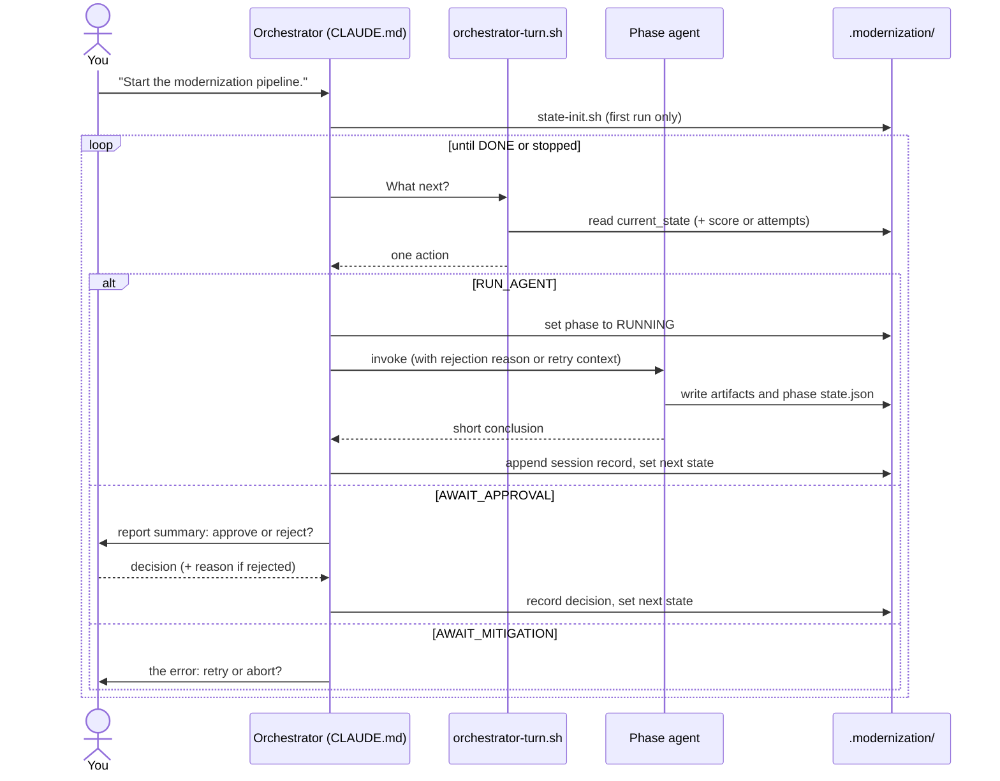
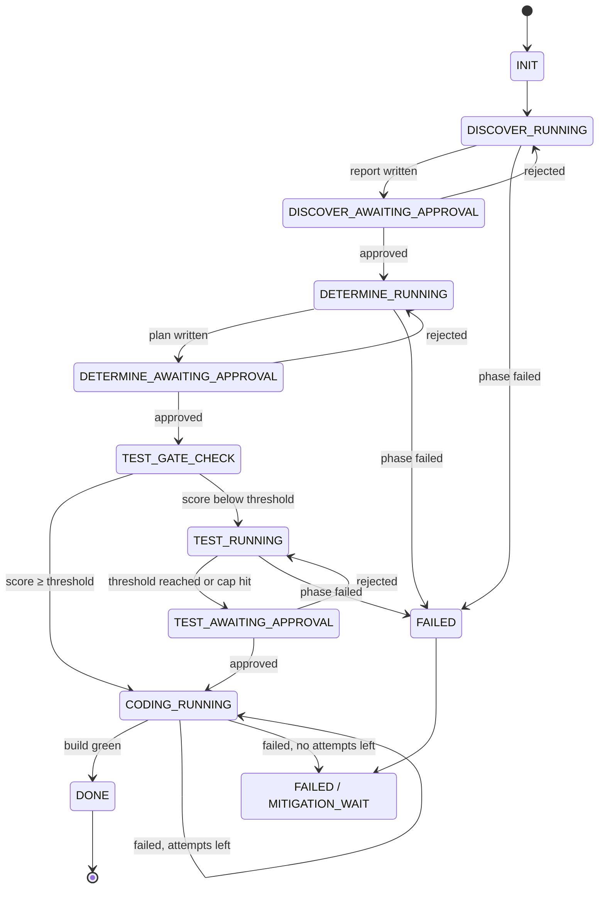

# Orchestrator

<h4>The conductor of the pipeline. It sequences the phases, remembers where a run is, and asks you before anything moves forward.</h4>

---

<div class="motto motto--orchestrator" markdown>

:material-sitemap-outline: **Orchestrator** <span>Coordinates</span>

- :material-magnify: **Discover** <span>Collects</span>
- :material-scale-balance: **Determine** <span>Plans</span>
- :material-test-tube: **Test** <span>Strengthens</span>
- :material-code-braces: **Code** <span>Upgrades</span>

</div>

## What it is

The orchestrator is **not a subagent**. It is the **main Claude Code session itself**, driven by the
project's `CLAUDE.md`. It invokes one phase agent at a time, waits for it to finish, then decides what
happens next.

Its work splits into two halves, and each half lives in a different place:

<div class="versus" markdown>

<div markdown>

<span class="versus__label">:material-cog-outline: Bookkeeping</span>

<span class="versus__where">Lives in the `orchestrator` skill</span>

- Read and write `state.json`
- Decide the next state transition
- Compare a score with a threshold

Scripts only. **No judgment.**

</div>

<div markdown>

<span class="versus__label">:material-brain: Judgment</span>

<span class="versus__where">Lives in `CLAUDE.md`</span>

- Invoke a phase agent with the right prompt
- Summarise a report for you
- Ask you to approve or reject, and react to it

The main session's **own reasoning**.

</div>

</div>

Neither half can replace the other. A skill **cannot** invoke a subagent or ask you a question. And
state transitions should **not** be re-derived from prose every turn, where they can drift, so they
are encoded once as a lookup table in a read-only script.

<div class="grid cards" markdown>

-   <span class="card-title">:material-numeric-1-circle-outline: One phase at a time</span>

    ---

    Phase agents run **synchronously**. Nothing to poll, no two phases ever overlap.

-   <span class="card-title">:material-content-save-outline: State lives in files</span>

    ---

    Every decision and invocation is recorded under `.modernization/`. **Stop, resume, audit.**

-   <span class="card-title">:material-shield-outline: Agents stay isolated</span>

    ---

    Each agent starts with a **clean context** and a short prompt. It reads the rest itself.

</div>

---

## The pipeline

!!! example "The orchestrator's flow"

    ```mermaid
    flowchart TD
        OA(["orchestrator"])
        OA -->|" 1. calls "| DA["discover-agent"]
        DA -->|" produces "| DR[("discover-report.md")]
        DR -->|" reviewed by "| OA
        OA -.->|" rejected → revise "| DA
        OA -->|" 2. approved → calls "| DETA["determine-agent"]
        DETA -->|" produces "| DETR[("modernization-plan.md")]
        DETR -->|" reviewed by "| OA
        OA -.->|" rejected → revise "| DETA
        OA -->|" 3. testability < 80% → calls "| TA["test-agent"]
        TA -->|" produces "| TR[("tests + testability-report.md")]
        TR -->|" reviewed by "| OA
        OA -.->|" rejected → revise "| TA
        OA -->|" 4. testability ≥ 80% → calls "| CA["coding-agent"]
        CA -->|" once the build passes "| MP[("upgrade + modernization-summary-report.md")]
    ```

You approve each phase's report before the next one starts. **Test** runs only when the testability
score is below the threshold. **Code** ends with a branch ready for your review.


### Checkpoints

<div class="versus checkpoints" markdown>

<div markdown>

<span class="versus__label">:material-cog-outline: Mechanical checks</span>

<span class="versus__where">Decided from a number, without asking</span>

- **Test gate**
  <span>Score ≥ threshold → Code, else → Test</span>
- **Build verification**
  <span>Build and tests pass → Done, else retry, then ask you</span>

</div>

<div markdown>

<span class="versus__label">:material-account-check-outline: Human gates</span>

<span class="versus__where">You approve, or reject with a reason</span>

- `discover-report.md`
  <span>Rejected → Discover re-runs</span>
- `modernization-plan.md`
  <span>Rejected → Determine re-runs</span>
- `testability-report.md`
  <span>Rejected → Test continues</span>

</div>

</div>

!!! note "Why the code phase has no approval gate"

    Its changes are judged by **whether the build and tests pass**. The human review happens when
    you **inspect and merge its branch**.

---

## Building blocks

<div class="grid cards" markdown>

-   <span class="card-title">:material-script-text-outline: Orchestrator prompt</span>

    ---

    Runs the turn loop, invokes agents, asks you questions.

    `CLAUDE.md`

-   <span class="card-title">:material-cog-outline: Orchestrator skill</span>

    ---

    Creates, reads and updates state files. Decides the next step.

    `.claude/skills/orchestrator/`

-   <span class="card-title">:material-robot-outline: Phase agents</span>

    ---

    One specialist per phase, each with its own context and tools.

    `.claude/agents/<phase>-agent.md`

-   <span class="card-title">:material-toolbox-outline: Skills</span>

    ---

    Reusable procedures the agents call: scripts plus instructions.

    `.claude/skills/<name>/`

-   <span class="card-title">:material-tune-variant: Settings</span>

    ---

    Tool permissions and pipeline configuration.

    `.claude/settings.json`

-   <span class="card-title">:material-folder-outline: State and artifacts</span>

    ---

    State files, reports, logs and worktrees, created at run time.

    `.modernization/`

</div>

| Agent | Skills it uses |
|---|---|
| `discover-agent` | `inventory` |
| `determine-agent` | `dependency-analysis`, `test-analysis` |
| `test-agent` | `testability` |
| `coding-agent` | `upgrade-java-spring-boot`, `build-verify`, `dependency-upgrade` |

Every agent also uses the `orchestrator` skill to read and write **its own** state file.

!!! info "Related, not interchangeable"

    - A **skill** knows *how* to do one job, not *when* to run.
    - An **agent** applies skills within its phase, but cannot move the pipeline or ask you anything.
    - Only the **orchestrator** sequences phases and talks to you.

### Who does what

<div class="grid cards roles" markdown>

-   <span class="card-title">:material-console: Scripts</span>
    <span class="role">Everything deterministic</span>

    ---

    Run Maven, generate the SBOM, compute coverage, edit `pom.xml`, verify a build.

-   <span class="card-title">:material-robot-outline: Agents</span>
    <span class="role">Everything that needs judgment</span>

    ---

    Write the plan, pick classes to test, write tests, repair code after OpenRewrite.

-   <span class="card-title">:material-sitemap-outline: Orchestrator</span>
    <span class="role">Sequencing</span>

    ---

    Read state, ask a script what is next, invoke an agent or ask you.

-   <span class="card-title">:material-account-check-outline: You</span>
    <span class="role">Decisions</span>

    ---

    Approve or reject reports, choose target versions, review and merge.

</div>

Scripts write full output to log files and return **a single status line**. Agents read finished
summaries, never raw build output, so their context stays small.

---

## How a turn works



`orchestrator-turn.sh` is **read-only** and returns exactly one of four actions:

| Action | The orchestrator then… |
|---|---|
| `RUN_AGENT` | Invokes the next phase agent and records the session |
| `AWAIT_APPROVAL` | Summarises the report and asks you to approve or reject |
| `AWAIT_MITIGATION` | Shows the error and asks you to retry or abort |
| `DONE` | Reports the final summary and stops |

<p class="kicker">The state machine is a <strong>lookup table</strong>, so the running pipeline cannot drift from the designed flow.</p>

---

## Configuration

All configuration lives in `.claude/settings.json`, in two blocks:

<div class="versus" markdown>

<div markdown>

<span class="versus__label">:material-variable: Env</span>

Pipeline settings, passed as **environment variables** to every command the agents run.

</div>

<div markdown>

<span class="versus__label">:material-lock-outline: Permissions</span>

Which commands and files the agents may use **without asking**.

</div>

</div>

### Pipeline settings

| Variable | Default | Phase | Meaning |
|---|---|---|---|
| `MODERNIZATION_TESTABILITY_THRESHOLD` | `80` | Determine, Test | Score (%) needed to skip Test, and the target Test works toward |
| `MODERNIZATION_JACOCO_WEIGHT` | `0.6` | Determine, Test | Weight of JaCoCo line coverage |
| `MODERNIZATION_PIT_WEIGHT` | `0.4` | Determine, Test | Weight of PIT mutation strength |
| `MODERNIZATION_TEST_MAX_ITERATIONS` | `5` | Test | Max write-tests-and-re-measure rounds |
| `MODERNIZATION_CODING_MAX_ATTEMPTS` | `3` | Code | Attempts before asking you to retry or abort |
| `MODERNIZATION_TARGET_JAVA_VERSION` | `25` | Code | Default Java version offered |
| `MODERNIZATION_TARGET_SPRING_BOOT_VERSION` | `4.0` | Code | Default Spring Boot version offered |
| `MODERNIZATION_CODING_BUMP_BATCH_SIZE` | `1` | Code | Dependency bumps per build verification |
| `MODERNIZATION_CODING_MAX_BUMPS` | `0` | Code | Max bumps per invocation (`0` = no limit) |

!!! abstract "Testability score"

    **line coverage % × JaCoCo weight + PIT strength % × PIT weight**

    Keep the two weights summing to **1**.

Discover also accepts a few advanced variables (scanner choice, task timeouts). See
[Discover](../discover/index.md).

<!-- TODO: target versions — the default target versions above, the target named in
     modernization-plan.md, and the versions the upgrade recipes support are being aligned in code.
     Update this note once that is done. -->

### Permissions

!!! success "Allowed without asking"

    - The pipeline's own scripts under `.claude/skills/*/scripts/`
    - `mvn`, `./mvnw`, `mvn -v`, `java -version`
    - Read-only git: `status`, `branch`, `diff`, `log`, `worktree`
    - Commits and resets **only inside the pipeline's worktrees** (`git -C .modernization/test/worktree …`,
      `git -C .modernization/code/worktree …`)
    - Anything under `.modernization/`
    - Basic shell: `ls`, `cat`, `find`, `head`, `tail`, `wc`, `echo`, `pwd`, `cp`, `mkdir -p .modernization/**`

!!! warning "Always asks first"

    `git push`, and `git commit` or `git reset` **on your own branch**.

!!! danger "Always denied"

    `.env`, any `*.pem` file, and anything under `secrets/`.

<p class="kicker">Least privilege: agents build, test and commit freely <strong>inside their own worktrees</strong>, and nowhere else.</p>

Extending the pipeline with a new script? Add its **exact path** to `allow`, rather than broadening an
existing pattern.

### Changing configuration safely

!!! tip "Edit `settings.json` before you start a run"

    - At run start, `state-init.sh` **snapshots** the threshold, weights and caps into `gates` in
      `.modernization/state.json`.
    - The test gate uses that snapshot, so a mid-run change won't alter a plan you already approved.
      Some scripts read the environment directly (weights, batch size), so mid-run edits apply
      **unevenly**. Avoid them.
    - **Score looks wrong?** Check the testability report's *Configuration* section. "Built-in
      default" where you expected your own values means the script ran outside a Claude Code session.

---

## State

<p class="kicker">The pipeline's memory lives <strong>in files, not in the chat</strong>. Close the session any time, resume later, and see exactly what happened.</p>

Each phase records **which steps it has finished**. The orchestrator records **which phase the run is
in** and **what you have approved**.

### Where state lives

```text
.modernization/
├── state.json                      Top-level run state (orchestrator)
├── discover/
│   ├── state.json                  Discover step progress
│   ├── discover-report.md          ► Report you approve
│   ├── summary.md                  Scan task table (state, duration)
│   ├── bom-catalog/                Reference BOM data for Determine
│   └── <task>/                     One folder per scan task, each with logs/
├── determine/
│   ├── state.json                  Includes outputs.testability_score
│   ├── modernization-plan.md       ► Report you approve
│   ├── dependency-report.md
│   ├── plugin-report.md
│   ├── testability-report.md
│   ├── testability-data.csv
│   ├── dependency-analysis/logs/
│   └── test-analysis/logs/
├── test/                           Only if the test phase runs
│   ├── state.json
│   ├── testability-report.md       ► Report you approve
│   ├── iterations/<n>/             Measurements per round
│   └── worktree/                   Git worktree with the new tests
├── code/
│   ├── state.json
│   ├── worktree/                   Git worktree with the upgrade
│   ├── upgrade-worklist.csv        Per-dependency status
│   ├── dependency-report.md        Refreshed after the upgrade
│   ├── change-log.md
│   └── build-report.md
└── modernization-summary-report.md ► Final summary
```

**►** marks the files written **for people**. Everything else is machine state, intermediate data or
logs.

!!! note "One change outside `.modernization/`"

    On its first run inside a git repository, Discover adds `.modernization/` to your `.gitignore` if
    it is missing. You will see it as an **uncommitted edit**.

### The state machine



| State | Meaning |
|---|---|
| `INIT` | Run created, nothing started |
| `<PHASE>_RUNNING` | The phase's agent is working, or runs next turn |
| `<PHASE>_AWAITING_APPROVAL` | Waiting for your decision. **Not stuck** |
| `TEST_GATE_CHECK` | Next turn compares the score with the threshold |
| `FAILED` | A phase failed. You are asked to retry or abort |
| `DONE` | Green build. Branch ready for review |

!!! tip "Not every stop is a failure"

    - A test phase that hits its **iteration cap** still writes a report and waits for your approval.
    - A failing code phase **retries on its own** up to `MODERNIZATION_CODING_MAX_ATTEMPTS` before
      asking you.

### Who writes what

| File | Field | Written by |
|---|---|---|
| `.modernization/state.json` | Everything | :material-sitemap-outline: Orchestrator only |
| `.modernization/<phase>/state.json` | `status`, `steps`, `outputs`, `error`, `attempt`, `max_attempts` | :material-robot-outline: That phase's agent |
| `.modernization/<phase>/state.json` | `sessions` | :material-sitemap-outline: Orchestrator, after **every** invocation |

All writes go through `state-set.sh` or `state-append-session.sh`: write to a temp file, then rename.
A killed process **can never leave a half-written state file**.

??? info "Key fields reference"

    | File | Field | What it tells you |
    |---|---|---|
    | `state.json` | `run_id` | Unique ID for this run, also used in branch names |
    | `state.json` | `current_state` | Where the run is in the state machine |
    | `state.json` | `phases.<phase>.status` | `pending` until you decide, then `approved` or `rejected` |
    | `state.json` | `gates.*` | Settings snapshotted at run start, plus your chosen target versions |
    | `<phase>/state.json` | `status` | `running`, `reported`, `completed` or `failed` |
    | `<phase>/state.json` | `steps` | Which steps are done. This makes resume **step-level** |
    | `<phase>/state.json` | `error` | `{message, step, occurred_at}` when the phase failed |
    | `<phase>/state.json` | `sessions` | One entry per invocation: session ID, start, end, transcript |
    | `determine/state.json` | `outputs.testability_score` | The number the test gate compares |

    Phases are named `discover`, `determine`, `test` and `code` in state files and directories.

To watch these during a run, see
[monitoring](https://github.com/paul58914080/java-springboot-modernization-claude-agent/blob/main/docs/monitoring.md).

---

<div class="grid cards phases" markdown>

-   <span class="card-title">:material-magnify: [Discover](../discover/index.md)</span>

    ---

    **Collects** a factual inventory of dependencies, versions, vulnerabilities and test coverage. Changes nothing.

-   <span class="card-title">:material-scale-balance: [Determine](../determine/index.md)</span>

    ---

    **Plans** the upgrade from that evidence, and scores whether your tests are strong enough to trust it.

-   <span class="card-title">:material-test-tube: [Test](../test/index.md)</span>

    ---

    **Strengthens** weak tests, round by round on its own branch, before anything is upgraded.

-   <span class="card-title">:material-code-braces: [Code](../code/index.md)</span>

    ---

    **Upgrades** Java, Spring Boot and dependencies, one verified commit at a time.

</div>
