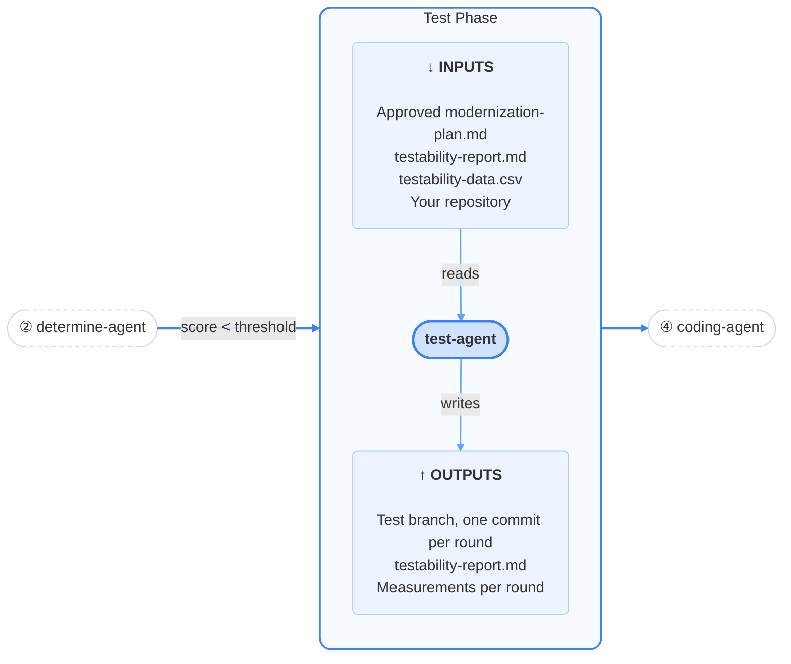
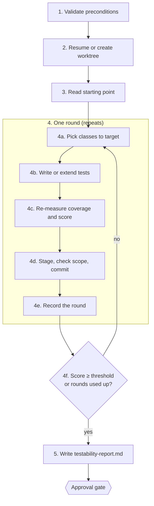

# Test

<h4>The safety net of the pipeline. It writes tests in rounds, on its own branch, to raise the testability score before anything is upgraded.</h4>

---

<div class="motto motto--third" markdown>

:material-sitemap-outline: **Orchestrator** <span>Coordinates</span>

- :material-magnify: **Discover** <span>Collects</span>
- :material-scale-balance: **Determine** <span>Plans</span>
- :material-test-tube: **Test** <span>Strengthens</span>
- :material-code-braces: **Code** <span>Upgrades</span>

</div>

## What this is

The test phase runs only when the determine phase's testability score is below the threshold.
`test-agent` writes new JUnit tests, or extends existing ones, in a separate git worktree on its own
branch. After each round it re-measures JaCoCo coverage and PIT mutation strength, commits that
round's tests, and repeats until the score reaches the threshold or it has used its allowed number of
rounds. It then writes `testability-report.md` and the pipeline stops for you to approve it.

### Purpose

An upgrade is only as trustworthy as the tests that check it. If the existing tests would miss
regressions, the code phase's "the build is green" signal means little. This phase raises the
safety net before any production code changes, and leaves every round of new tests as a separate
commit you can review. Coverage and mutation strength are proxies for test quality, not proof of it,
which is why you review the tests before approving.

## At a glance



| | |
|---|---|
| **Agent** | `test-agent` |
| **Skills** | `testability` (plus `orchestrator` for state) |
| **Runs when** | The test gate finds the score below `MODERNIZATION_TESTABILITY_THRESHOLD`, or no score was recorded |
| **Inputs** | Approved `modernization-plan.md`, `testability-report.md` and `testability-data.csv` from determine; your repository |
| **Outputs** | Branch `modernization/test-agent-<run_id>` with one commit per round; `.modernization/test/testability-report.md`; measurements per round |
| **Human gate** | Yes: approve or reject `testability-report.md` |
| **Next phase** | Code (on approve); test again with your reason (on reject) |
| **Changes to your repository** | Test code, and test-scoped dependencies in `pom.xml`, only inside `.modernization/test/worktree`. Your checked-out branch is not touched |

## What it does

The agent sets up a separate worktree, then writes tests in rounds. Each round targets the weakest
classes, re-measures the score and commits. Rounds stop when the score reaches the threshold or the
allowed number of rounds is used up.



### Stage 1: Validate preconditions

The agent confirms the run is in `TEST_RUNNING` (it never re-decides the test gate itself), that the
determine phase's plan, testability report and per-class data exist, and that the repository is a git
work tree. Git is required here, not optional. If anything is missing it stops before creating a
worktree.

### Stage 2: Resume or create the worktree

On a fresh run the agent creates `.modernization/test/state.json`, with `attempt` set to 0 and
`max_attempts` taken from the run's `gates.test_max_iterations` (copied from
`MODERNIZATION_TEST_MAX_ITERATIONS` at run start, default 5). It then creates the worktree:

```bash
git worktree add .modernization/test/worktree -b modernization/test-agent-<run_id> HEAD
```

All test-writing happens in this worktree. Because `.modernization/` is in `.gitignore`, the worktree
does not show up in your normal `git status`.

If the worktree already exists, from an interrupted session or after you rejected the report, the
agent reuses it and continues from the recorded `attempt`. It never recreates the worktree or
discards earlier commits.

**Output:** worktree and branch `modernization/test-agent-<run_id>`

### Stage 3: Read the starting point

The agent reads determine's `testability-report.md` (the score before any new tests) and
`testability-data.csv` (every class, worst first). The final report links back to this starting point.

### Stage 4: Rounds of test-writing

Each round increases `attempt` by one and then:

#### 4a. Pick classes to target

From the latest per-class data (determine's on the first round, the previous round's measurement
after that), the agent picks a batch of classes below the threshold where a modest number of tests
would raise the score most. Batch size is the agent's judgment: large enough to make progress, small
enough that the next measurement gives useful feedback.

#### 4b. Write or extend tests

The agent writes or extends JUnit tests under `src/test/java` in the worktree. This is the phase's
main judgment step. It may add a **test-scoped** dependency to a `pom.xml`, such as a mocking library
if the project has none. It never changes production code under `src/main`, never adds a production
dependency, and never touches `<dependencyManagement>`.

**Output:** new or changed test files

#### 4c. Re-measure

```bash
.claude/skills/testability/scripts/measure-testability.sh \
  .modernization/test/worktree .modernization/test/iterations/<attempt>
```

This runs a real Maven build on the **current** JDK (the code is not upgraded yet) with JaCoCo, then PIT mutation testing in a separate temporary copy (so
the PIT plugin added for measurement never ends up in the `pom.xml` that gets committed), and scores
the result with the same formula as the determine phase. It is a full measurement every time, not a
cached one, so each round takes about as long as discover's coverage scans.

A non-zero exit here means the build or the test suite failed, not that the score is low. See
[Failure handling](#failure-handling).

**Output:** `.modernization/test/iterations/<n>/` containing `coverage-jacoco/`, `coverage-pitest/`,
`testability-report.md` and `testability-data.csv`

#### 4d. Stage, check scope, commit

```bash
git -C .modernization/test/worktree add -A -- . ':!**/target' ':!**/target/**'
.claude/skills/testability/scripts/check-scope.sh .modernization/test/worktree <previous-commit>
git -C .modernization/test/worktree commit -m "<header>" -m "<body>"
```

- Build output under `target/` is always excluded, even if your project's `.gitignore` does not
  exclude it.
- `check-scope.sh` checks the **staged** changes and fails, naming each file, if anything outside
  `src/test/**` or a `pom.xml` changed. On failure the agent unstages, fixes the change and tries again
  within the same round. A failing scope check is never committed.
- Commits use [Conventional Commits](https://www.conventionalcommits.org/), with the round and score
  change in the body:

```
test(testability): raise coverage on OrderService, PricingEngine

Iteration 2/5 of automated test remediation (test-agent).
Weighted testability score: 71.20% -> 76.85% (threshold: 80%)
```

The agent is allowed to commit only with `git -C .modernization/test/worktree commit`. A plain
`git commit` anywhere else would ask you first.

**Output:** one commit on the test branch

#### 4e. Record the round

The agent updates its state file: `attempt`, the latest `outputs.testability_score`, and an entry in
`steps.iterations` with the classes targeted, score before and after, and the commit SHA.

#### 4f. Check whether to stop

- **Score at or above the threshold:** stop, with `outputs.threshold_reached: true`.
- **All rounds used and still below:** stop, with `outputs.threshold_reached: false`. This is **not a
  failure**: the agent still writes a report and you decide whether the improvement is enough.
- **Otherwise:** start the next round.

### Stage 5: Write the report

**Output:** `.modernization/test/testability-report.md`, with these sections:

| Section | Contents |
|---|---|
| Starting point | Link to determine's testability report, and the starting score and threshold |
| Remediation summary | How many rounds ran, the final score, whether the threshold was reached, which classes were targeted |
| Iteration history | One row per round: classes targeted, score before, score after, commit |
| Where to see the changes | The worktree path, branch name, and the `git log` and `git diff` commands to inspect the tests |
| Outcome | "Reached threshold after N iterations", or that the iteration cap was reached below the threshold |

The agent then marks the `report` step complete and sets `status: reported`.

### Outputs summary

| Artifact | Path | For people? |
|---|---|---|
| Report | `.modernization/test/testability-report.md` | Yes |
| New tests, one commit per round | Branch `modernization/test-agent-<run_id>` in `.modernization/test/worktree/` | Yes |
| Measurement per round | `.modernization/test/iterations/<n>/` | When debugging |
| State, including iteration history | `.modernization/test/state.json` | Readable |

## Failure handling

| Situation | What happens |
|---|---|
| Re-measurement fails (build breaks or tests fail) | Phase failure. The agent records `error` with `step: iteration_<n>` and stops. The worktree and earlier commits are kept for debugging or a retry |
| Scope check fails | Not a phase failure. Fixed and retried within the round; escalated only if no in-scope change can be produced |
| Iteration cap reached below threshold | Not a failure. Report written, waits for your approval |
| Preconditions missing | Stops before creating or touching a worktree |

## The approval gate

The orchestrator shows a summary of `testability-report.md` and asks you to approve or reject it.
Before approving:

- **Read the tests, not just the score.** Inspect them on the branch:

  ```bash
  git -C .modernization/test/worktree log --oneline modernization/test-agent-<run_id>
  git -C .modernization/test/worktree diff <base-commit> modernization/test-agent-<run_id>
  ```

  Look for tests that assert real behaviour, rather than tests that only execute code to raise
  coverage.
- **Check the outcome.** Did the score reach the threshold, or did the agent run out of rounds?

**Approve** and the run moves to the code phase, with whatever improvement was made.

**Reject with a reason** and the agent continues from where it stopped, with your reason as guidance.
Earlier commits are kept; a rejection here usually means "keep going", not "start over".

**If the iteration cap was reached**, rejecting does not give the agent more rounds: the cap counts
every round across the whole phase, including rounds after a rejection. The agent will report that no
rounds remain and name the setting to raise. Your options are to approve and proceed with the partial
improvement, or to raise `MODERNIZATION_TEST_MAX_ITERATIONS` and start a fresh run, because the cap for this run was fixed when it started.

**Approving does not merge the branch.** To keep the new tests in your own branch regardless of what
the code phase does, merge or cherry-pick them yourself, or push the branch and open a pull request:

```bash
git merge modernization/test-agent-<run_id>
```

## Configuration

| Variable | Default | Meaning |
|---|---|---|
| `MODERNIZATION_TEST_MAX_ITERATIONS` | `5` | Maximum rounds for the whole phase, including rounds after a rejection. Copied to `gates.test_max_iterations` at run start, then into this phase's `max_attempts` |
| `MODERNIZATION_TESTABILITY_THRESHOLD` | `80` | The score the phase works toward |
| `MODERNIZATION_JACOCO_WEIGHT` | `0.6` | Line coverage weight used when re-measuring |
| `MODERNIZATION_PIT_WEIGHT` | `0.4` | Mutation strength weight used when re-measuring |

The iteration cap is fixed when the run starts. Changing `settings.json` during a run does not change
it.

## Troubleshooting

| Symptom | Cause | Fix |
|---|---|---|
| `required input not found`, or determine artifacts missing | Determine not approved, or session started from the wrong folder | Start the session from the repository root |
| Phase failed at `iteration_<n>` | The build or test suite failed during re-measurement | Look in `.modernization/test/iterations/<n>/` and the worktree; fix, then retry from the failure prompt |
| A round's changes look wrong | The agent's tests need correcting | Every round is a separate commit; inspect with `git -C .modernization/test/worktree log -p`. Nothing is squashed |
| Score barely moves despite new tests | Remaining PIT gaps may be *equivalent mutants*: code changes that no test could detect because behaviour does not change | Check the report's remediation summary; approve if the remaining gap is not real test weakness |
| Iteration cap reached repeatedly | The cap counts all rounds in the phase | Approve, or raise the setting and start a fresh run |
